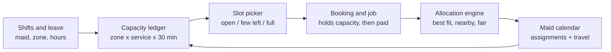

# Maid Booking Platform — Backend Technical Spec

Nov 19, 2026 · @Sachin Mehta

## Overview and operating model

The platform sells **time slots in a zone**, not individual maids. Customers pick a service, a time (or "now"), and optionally a preferred maid. The platform reserves zone capacity, takes payment, and then **assigns** a maid. This is how Urban Company (book a slot, auto-assigned professional) and Snabbit / UC InstaHelp (experts on shifts in micro-zones, dispatched within 10–15 minutes) run. It replaces the earlier "check whether this maid is free" design.

**Three layers, each owning one question**

| Layer | Question it answers | Source of truth |
| --- | --- | --- |
| Supply | Who is working, where, and when? | Maid shifts and leave in a zone, plus live state for instant jobs |
| Capacity | Can we take one more job in this zone, service and 30-minute bucket? | A capacity ledger of minutes available vs reserved |
| Allocation | Which maid does this job? | Each maid's calendar of assignments, including travel buffers |

Customers see capacity. Maids see assignments. The two are linked by a single job record.

**How the brief maps to this model**

- *Maid discovery* has two modes. **Slot discovery** (the default) shows open slots for a locality and service. **Preferred-maid search** lists maids who are on shift and free for a slot, with filters for rating, tier/price, skills and gender. Both read only real availability.
- *Addition of maid* means onboarding a profile, then giving the maid **shifts** in a zone. Availability is modelled as shifts minus assignments.
- *Booking types* all produce **jobs**. Instant is dispatched now, Scheduled is allocated after payment, and Recurring is a subscription that generates jobs on a rolling window.
- *Payment* and *cancellation* work per job. Cancelling a job releases its capacity and its maid assignment, so the slot is immediately bookable again.

**Goals, in priority order**

1. Never over-promise: zone capacity is never over-reserved, and no maid gets overlapping assignments, even with concurrent requests.
2. Clear extension points: filters, booking types, allocation and scoring strategies, payment methods, cancellation policies and pricing each plug in as one new class.
3. An accurate domain model with explicit, guarded state machines.
4. Meaningful unit tests for the core business logic.

**Out of scope:** authentication, UI, production persistence, deployment, real payment gateways, maps and routing (travel time is an estimate per zone pair), and demand forecasting (shifts are given as input).

### At a glance



Shifts and maid calendars together set the free minutes in the ledger. Customers book against the ledger, and the allocation engine later writes the job into one maid's calendar, which uses up that time.

## Tech stack and project structure

The stack is Java 17, Spring Boot 3.x and Maven, with in-memory repositories behind interfaces and an injected `Clock`.

| Concern | Choice |
| --- | --- |
| Language / framework | Java 17, Spring Boot 3.x (web, validation, scheduling) |
| Build | Maven, single module, `mvn spring-boot:run` |
| Persistence | `ConcurrentHashMap`-backed repositories behind interfaces |
| Tests | JUnit 5, AssertJ, Mockito; `@WebMvcTest` for a few controllers |
| API docs (bonus) | springdoc-openapi, Swagger UI at `/swagger-ui.html` |
| Time | Injected `java.time.Clock`, `LocalDateTime` in Asia/Kolkata, 30-minute capacity buckets |
| Seed data | 3 zones, about 12 maids, 7 days of shifts, loaded at startup |

The code is packaged by layer of the domain:

```
com.example.maidbooking
├── common/        Money, TimeSlot, errors, ClockConfig, LockRegistry
├── zone/          Zone, ZoneResolver, TravelTimeEstimator
├── supply/        Maid, Shift, ShiftTemplate, Leave, MaidLiveState, MaidService, ShiftService
├── capacity/      CapacityBucket, CapacityReservation, CapacityLedger, CapacityService
├── allocation/    Assignment, MaidCalendar, AllocationService, AllocationStrategy (BestFit),
│                  InstantDispatchStrategy, MaidScorer (+ scoring rules), AllocationJob
├── discovery/     SlotService, MaidSearchService, MaidFilter + factories, FilterRegistry
├── booking/       Booking, Job, Subscription, BookingService, SubscriptionService
│   └── type/      BookingTypeHandler + Instant / Scheduled / Recurring handlers
├── pricing/       RateCard, PricingStrategy, TierPricing, SurgePricingDecorator
├── payment/       Payment, PaymentProcessor + Card / UPI / Wallet, PaymentGateway, MockPaymentGateway,
│                  IdempotencyStore, RecurringChargeJob
├── cancellation/  CancellationPolicy, TimeBasedCancellationPolicy, RefundDecision, CancellationService
└── api/           controllers, DTOs, GlobalExceptionHandler
```

The dependency direction is `booking` → `capacity` + `allocation` → `supply` + `zone`. `supply` knows nothing about bookings. Controllers only map and validate; services orchestrate; entities own their invariants and state transitions.

## Domain model

The central record is the **Job**: one visit by one maid in one time slot. A Booking is the customer's order and holds one Job (Instant, Scheduled) or links to a Subscription that keeps generating Jobs (Recurring). Each Job holds exactly one capacity reservation, at most one active assignment, and its own payment.

### Supply

| Entity | Key fields | Notes |
| --- | --- | --- |
| `Zone` | id, name, localities (`Set<String>`), neighbourZoneIds | A micro-market under \~1 km across. `ZoneResolver` maps a locality or address to a zone. |
| `Maid` | id, name, gender, phone, `Set<ServiceType>` skills, `Set<String>` tags, `Tier`, rating, homeZoneId, `MaidStatus` | No availability on the maid. Tier drives price (STANDARD, PREMIUM). |
| `ShiftTemplate` | maidId, zoneId, `DayOfWeek`, startTime, endTime | The maid's preferred weekly pattern. It only **generates** shifts. |
| `Shift` | id, maidId, zoneId, date, `TimeSlot` window, `ShiftStatus` | The real unit of supply. A maid works one zone per shift. |
| `Leave` | maidId, from, to, reason | Cancels overlapping shifts and triggers re-allocation of their jobs. |
| `MaidLiveState` | maidId, `LiveStatus`, zoneId, freeAt | Used only for instant dispatch: IDLE, EN\_ROUTE, ON\_JOB, BREAK or OFFLINE. |

### Capacity

| Entity | Key fields | Notes |
| --- | --- | --- |
| `CapacityBucket` | zoneId, serviceType, date, bucketStart, capacityMinutes, reservedMinutes, version | One row per zone × service × 30 minutes. `free = floor(capacity × utilisationFactor) − reserved`. |
| `CapacityReservation` | id, jobId, zoneId, serviceType, `Map<bucketStart, minutes>`, `ReservationStatus`, expiresAt | HELD (until payment) → COMMITTED → RELEASED. |

### Allocation

| Entity | Key fields | Notes |
| --- | --- | --- |
| `Assignment` | id, jobId, maidId, shiftId, `TimeSlot` work, `TimeSlot` blocked, `AssignmentStatus` | `blocked` = travel buffer before + work. ACTIVE or RELEASED. |
| `MaidCalendar` | maidId, `TreeMap<LocalDateTime, Assignment>` | In-memory view of a maid's active assignments, for fast gap and overlap checks. |

### Demand

| Entity | Key fields | Notes |
| --- | --- | --- |
| `Booking` | id, customerId, zoneId, address, serviceType, `BookingType`, tier, preferredMaidId, preferences (gender), subscriptionId, jobIds, createdAt | Aggregate root for the customer's order. |
| `Job` | id, bookingId, zoneId, serviceType, `TimeSlot` slot, price, `JobStatus`, reservationId, assignmentId, maidId, paymentId, otp, holdExpiresAt | One visit. |
| `Subscription` | id, customerId, zoneId, serviceType, `RecurrenceRule`, tier, preferredMaidId, savedPaymentMethod, generatedUntil, `SubscriptionStatus` | Generates jobs 14 days ahead. ACTIVE, PAUSED or CANCELLED. |
| `Payment` | id, jobId, amount, method, status, gatewayRef, idempotencyKey, refundedAmount | One payment per job. |

### Value objects

`TimeSlot` (half-open `[start, end)`, `overlaps`, `buckets(30)`), `Money` (BigDecimal, INR), `RecurrenceRule` (days of week, startTime, duration, startDate, endDate, `expand(from, to)`), `RefundDecision`, `ScoredCandidate` (maid, score, reasons).

### State machines

Every transition is a guarded method on the entity, for example `job.assign(maid)` or `job.cancel(reason)`. An illegal transition throws `InvalidStateTransitionException`.

**JobStatus**

| From | To | Trigger |
| --- | --- | --- |
| PENDING\_PAYMENT | CONFIRMED | Payment succeeds; the capacity reservation is committed |
| PENDING\_PAYMENT | EXPIRED | 10-minute hold lapses; capacity is released |
| CONFIRMED | ASSIGNED | Allocation finds a maid |
| ASSIGNED | CONFIRMED | Maid drops out or goes on leave; the assignment is released and the job re-enters allocation |
| CONFIRMED | UNFULFILLED | No maid found by the allocation cutoff (default T−60 min); full refund |
| ASSIGNED | EN\_ROUTE | Maid starts travelling |
| EN\_ROUTE | IN\_PROGRESS | Maid enters the customer's OTP |
| IN\_PROGRESS | COMPLETED | Maid marks it done |
| PENDING\_PAYMENT, CONFIRMED, ASSIGNED | CANCELLED | Customer cancels before the maid is en route; the policy decides the refund |

COMPLETED, CANCELLED, EXPIRED and UNFULFILLED are terminal. For instant jobs, CONFIRMED → ASSIGNED happens in the same request.

**ShiftStatus**: PLANNED → CHECKED\_IN → ENDED, or PLANNED → ABSENT / CANCELLED. A shift adds to capacity while it is PLANNED or CHECKED\_IN.

**ReservationStatus**: HELD → COMMITTED → RELEASED, or HELD → RELEASED (expiry or cancellation). **PaymentStatus**: INITIATED → SUCCEEDED | FAILED; SUCCEEDED → PARTIALLY\_REFUNDED | REFUNDED.

**BookingStatus** is derived from its jobs (PENDING\_PAYMENT, ACTIVE, COMPLETED, CANCELLED), never set by hand.

## Capacity and allocation

A job is protected twice. At booking time, an atomic **zone capacity reservation** stops the platform from selling more minutes than the zone's maids can work. At allocation time, a **per-maid calendar check** stops any single maid from getting overlapping jobs. Customers book against the first; maids are bound by the second.

### Capacity ledger

**How capacity is built.** For every shift that is PLANNED or CHECKED\_IN, add the shift's minutes in each 30-minute bucket to `capacityMinutes` for its zone and for each service the maid offers. A maid with two skills counts in both service pools. A separate zone-level pool (service = `ANY`) counts her minutes only once. A reservation must fit **both** its service pool and the zone pool, so a multi-skilled maid is never sold twice. Shift and leave changes adjust the affected buckets incrementally through `CapacityService.onShiftChanged`.

**What a job needs.** A job needs `duration + travelBuffer` minutes, spread over the buckets its slot touches. The travel buffer comes from `TravelTimeEstimator` and defaults to 15 minutes in the same zone. For example, a 60-minute cleaning job at 09:00 needs 15 minutes in the 08:30 bucket (travel) plus 30 + 30 minutes in the 09:00 and 09:30 buckets.

**Utilisation factor.** Usable capacity is `floor(capacityMinutes × 0.85)`, a configurable value. Jobs never pack perfectly into maids' calendars, so selling 100% of raw minutes would leave some confirmed jobs with no maid. This is the simple version of Urban Company's "impact" term in their capacity formula.

**Reserve and release** — `CapacityService.reserve(zoneId, serviceType, slot, holdUntil)`:

1. Compute the needed minutes per bucket for both the service pool and the zone pool.
2. Under the zone lock (`LockRegistry.zone(zoneId)`), check that every bucket has enough free minutes. If any doesn't, throw `SlotUnavailableException` listing those buckets and reserve nothing.
3. Increment `reservedMinutes` on every bucket, bump each bucket's `version`, and save a HELD `CapacityReservation`.

`commit(reservationId)` clears the expiry. `release(reservationId)` decrements the same buckets by the stored per-bucket minutes, so a release always exactly undoes its own reserve. Expired HELD reservations are released lazily under the lock before every check, and also by a sweeper every minute.

### Slot availability for customers

`SlotService.slots(zone, service, date, duration, tier)` checks every 30-minute start time from 07:00 to 20:00 against the ledger. It returns OPEN, FEW\_LEFT (free capacity under 2 jobs' worth) or FULL, together with the quoted price. This is pure arithmetic on the ledger, with no per-maid search, so it stays fast. For the preferred-maid mode, `MaidSearchService` does check individual calendars (below).

### Allocation (scheduled and recurring jobs)

`AllocationService.allocate(job)` runs when a job becomes CONFIRMED, and is retried by `AllocationJob` every 5 minutes until the cutoff.

1. **Candidates:** maids whose shift in the job's zone, or a neighbour zone, fully covers `travelBuffer + slot`; who have the skill; who pass the booking's hard constraints (gender preference, tier, minimum rating), using the same `MaidFilter`s as search; and who are not on leave.
2. **Feasibility:** the maid's calendar has a gap for the blocked interval. The travel buffer is computed from her previous job's zone, and the gap after the job must allow travel to her next job.
3. **Scoring:** a `MaidScorer` combines weighted rules. Best fit scores highest when the remaining gap around the job is smallest, so calendars pack tightly (Urban Company's Best Fit approach). Further rules favour the preferred maid (a large bonus), lower travel from the previous job, fairness (fewer jobs today scores higher), and rating.
4. **Commit:** take the maid's lock (`LockRegistry.maid(maidId)`) and re-check the calendar for overlap. Write the `Assignment` and call `job.assign(maid)`. If the re-check fails, try the next candidate.
5. **No candidate:** the job stays CONFIRMED and is retried. At the cutoff it becomes UNFULFILLED: the capacity is released, the customer gets a full refund, and the event is logged for supply planning.

Locks are always taken in the order zone, then maid, to avoid deadlock. Allocation of a single job only ever takes one maid lock at a time.

### Instant dispatch

`InstantDispatchStrategy` handles "now" bookings, as Snabbit and UC InstaHelp do:

1. The slot starts at `now + ETA` (rounded up to 5 minutes) and lasts the requested duration.
2. Candidates are maids CHECKED\_IN in the zone or a neighbour, whose live state is IDLE (or ON\_JOB with `freeAt` early enough), whose ETA from `TravelTimeEstimator` is within the promise (default 15 minutes), and whose shift has room for the whole job.
3. Capacity is reserved for the slot as usual, then the best-scored candidate (lowest ETA first) is assigned immediately under her lock. Maids are on contract, so no accept/reject step is needed. An offer-and-accept flow can plug in as another `DispatchStrategy`.
4. If no candidate is found, return 409 `NO_MAID_NEARBY`, together with the next three OPEN scheduled slots.

### Preferred-maid mode

When a booking names `preferredMaidId`, the handler reserves capacity and then allocates **only** that maid, in the same request. If her calendar has no gap, the request fails with 409, and nothing stays reserved. Recurring subscriptions treat the preferred maid as a soft preference: they try her first and fall back to the best other maid, which keeps continuity without losing the visit.

### Why this beats a per-maid slot check

- The platform can promise a slot without committing a maid early. Allocating later packs calendars better and absorbs no-shows.
- Slot listing reads one ledger row per bucket, instead of scanning every maid's calendar.
- A maid dropping out re-allocates the job without the customer losing their slot, because the platform made the promise, not one maid.
- In production the ledger becomes a table with `UPDATE … SET reserved = reserved + :n WHERE reserved + :n <= :cap`, and the calendar becomes a table with a Postgres exclusion constraint on `(maid_id, tstzrange)`. The service interfaces stay the same.

## Key abstractions and extension points

Every extension point is an interface with small implementations registered as Spring beans. Each is looked up by a key from a registry that Spring builds by injecting `List<Interface>`. Adding a variant means adding one class; no existing class changes.

| Extension point | Interface | Shipped implementations | To add one |
| --- | --- | --- | --- |
| Maid filter (search + allocation constraint) | `MaidFilter` / `MaidFilterFactory` | MinRating, Tier, Skills, Gender | New factory bean with a query key |
| Candidate scoring | `ScoringRule` | BestFitGap, PreferredMaid, TravelDistance, Fairness, Rating | New rule bean + a weight in config |
| Allocation | `AllocationStrategy` | `BestFitAllocationStrategy` | New bean, chosen by `allocation.strategy` |
| Dispatch (instant) | `DispatchStrategy` | `NearestIdleDispatchStrategy` | E.g. `OfferAndAcceptDispatchStrategy` |
| Booking type | `BookingTypeHandler` | Instant, Scheduled, Recurring | New enum value + handler bean |
| Zone lookup / travel | `ZoneResolver`, `TravelTimeEstimator` | Locality map; same zone 15 min, neighbour 30 min | Geohash resolver, maps API |
| Payment method | `PaymentProcessor` | Card, UPI, Wallet over `MockPaymentGateway` | New enum value + processor bean |
| Cancellation policy | `CancellationPolicy` | TimeBased (default), NoRefund | New bean + `cancellation.policy` |
| Pricing | `PricingStrategy` | `TierPricing` + `SurgePricingDecorator` | New strategy or decorator |

### Filters, shared by search and allocation

```java
public interface MaidFilter {
    boolean test(Maid maid, MatchContext ctx);      // ctx: zone, service, slot, tier, preferences
}
public interface MaidFilterFactory {
    String key();                                   // "minRating", "gender", "tier", "skills"
    MaidFilter create(String rawValue);             // parse + validate → InvalidFilterException (400)
}
```

The same filter objects that narrow a preferred-maid search are stored on the booking as **hard constraints** and re-applied during allocation. A customer who asks for a female maid with a rating of 4 or more therefore gets exactly that, whether they pick the maid or the platform does. A new filter, for example `languages`, is one factory class and works in both places.

### Scoring

```java
public interface ScoringRule {
    String name();
    double score(Maid maid, MaidCalendar cal, Job job, MatchContext ctx);   // 0..1
}
// MaidScorer = Σ weight(rule) × rule.score(...); weights from application.yml
```

`ScoredCandidate` keeps each rule's contribution, so tests and logs can explain why a maid was picked.

### Booking types

```java
public interface BookingTypeHandler {
    BookingType type();
    void validate(CreateBookingRequest req, LocalDateTime now);
    BookingPlan plan(CreateBookingRequest req, LocalDateTime now);   // job slots + optional Subscription
    AllocationMode allocationMode();                                // DISPATCH_NOW | ALLOCATE_AFTER_PAYMENT
}
```

- **Instant:** the plan is one job at `now + ETA`. Mode is DISPATCH\_NOW: capacity is reserved and a maid is assigned in the same request, and the job awaits payment with the maid already held.
- **Scheduled:** the plan is one job at the chosen start, between 2 hours and 30 days ahead. Mode is ALLOCATE\_AFTER\_PAYMENT.
- **Recurring:** the plan is a `Subscription` plus jobs for the first 14 days. Mode is ALLOCATE\_AFTER\_PAYMENT. `SubscriptionService` generates further jobs daily.

`BookingService.create` runs one template for every type: handler → validate → plan → price → reserve capacity for every job (all or nothing) → save → allocate now if the mode is DISPATCH\_NOW. There is no `switch` on booking type.

### Payments

```java
public interface PaymentProcessor {
    PaymentMethodType method();
    void validate(PaymentDetails details);
    GatewayResult charge(Money amount, PaymentDetails details, String idempotencyKey);
    GatewayResult refund(Payment payment, Money amount);
}
public interface PaymentGateway { GatewayResult charge(GatewayChargeRequest r); GatewayResult refund(GatewayRefundRequest r); }
```

`PaymentDetails` is a sealed interface whose permitted types are `CardDetails`, `UpiDetails` and `WalletDetails`. `MockPaymentGateway` can be told to fail in tests.

### Cancellation policy

```java
public interface CancellationPolicy {
    RefundDecision evaluate(Job job, Payment payment, CancelledBy who, LocalDateTime at);
}
```

| Situation | Refund |
| --- | --- |
| Platform-caused (UNFULFILLED, maid no-show) | 100% |
| Customer cancels more than 4 h before start | 100% |
| Customer cancels 1–4 h before start | 50% |
| Customer cancels under 1 h before, or after the maid is assigned for an instant job | 0% |
| Maid EN\_ROUTE or later | Not cancellable (409) |

The thresholds are configuration properties.

### Pricing

```java
public interface PricingStrategy { Money price(ServiceType s, Tier t, TimeSlot slot, ZoneId z, BookingType type); }
```

Prices are set by the platform, as on Urban Company and Snabbit, not by each maid: `TierPricing` charges a rate card per service per hour × a tier multiplier. `SurgePricingDecorator` adds an uplift when a bucket's free capacity is below 20%, plus a fixed premium for instant jobs. A job's price is locked when it is reserved.

## Core flows

Each flow is one service method that tests can drive directly, without HTTP.

### 1. Onboard a maid and give her shifts — `MaidService`, `ShiftService`

1. `onboard(profile)` validates the name, at least one skill, a tier and a home zone, then saves the maid as ACTIVE.
2. `setTemplate(maidId, weeklyWindows)` stores her preferred weekly pattern. `generateShifts(from, to)` turns templates into `Shift`s, skipping leave days and refusing overlaps with her existing shifts.
3. Each new or changed shift calls `CapacityService.onShiftChanged`, which adds or removes minutes in the affected buckets.
4. `addLeave(maidId, from, to)` cancels the overlapping shifts, removes their capacity, and releases any assignments on those shifts back to allocation. If capacity would go negative, the system still accepts the leave: the jobs stay confirmed and are re-allocated, possibly from neighbour zones, so the customer never loses the slot.

### 2. Discover

- **Slots (default):** `SlotService.slots(locality, service, date, duration, tier)` resolves the zone, reads the ledger, and returns each start time as OPEN, FEW\_LEFT or FULL with a price.
- **Instant check:** `SlotService.instantAvailability(locality, service, duration)` returns whether a maid can arrive within 15 minutes, with an ETA. It reads live state; nothing is reserved.
- **Preferred-maid search:** `MaidSearchService.search(locality, service, slot, filters, page)` lists maids on shift covering the slot, whose calendar has a feasible gap and who pass every filter. Results are sorted by rating, then tier price, and show the quoted price. This satisfies the brief's "browse maids" requirement while still showing only maids who are actually available.

### 3. Book — `BookingService.create`

1. Resolve the zone, pick the handler by type, then validate and plan.
2. Price each planned job.
3. Reserve capacity for every job as HELD with a 10-minute expiry. Recurring bookings reserve all jobs in the first 14 days; if any one fails, every reservation made so far is released and the response lists the dates that clashed.
4. For DISPATCH\_NOW (instant) or a preferred maid, allocate immediately. The assignment is created with the hold and becomes active on payment. If allocation fails, release the capacity and return 409.
5. Save the booking and its jobs (PENDING\_PAYMENT), and the subscription if there is one. Return the jobs and the amount due now.

### 4. Pay — `PaymentService.pay(jobId, method, details, idempotencyKey)`

1. Check the idempotency store: the same key with the same body replays the stored result; the same key with a different body returns 422.
2. The job must be PENDING\_PAYMENT with an unexpired hold, otherwise 409.
3. Charge through the method's processor.
4. **On success:** commit the capacity reservation, mark the job CONFIRMED, then either activate the held assignment (ASSIGNED) or call `AllocationService.allocate(job)` synchronously. If allocation fails here, the job remains CONFIRMED and `AllocationJob` retries it.
5. **On failure:** the job stays PENDING\_PAYMENT and the customer can retry until the hold expires (402).

### 5. Recurring jobs — `SubscriptionService` and `RecurringChargeJob`

- At creation, the customer pays the first job. The other jobs in the first 14 days are committed without a hold expiry, because the subscription is the commitment.
- Every day `generate()` extends each ACTIVE subscription by one day of jobs: it reserves capacity and tries the preferred maid first, then anyone. If a date has no capacity, it is recorded as SKIPPED\_NO\_CAPACITY and the customer is notified. The series is not cancelled.
- `RecurringChargeJob` charges each job 24 hours before it starts, using the saved method and the key `jobId:charge`. If the charge fails, that job is cancelled, its capacity and assignment are released, and the rest of the series is unaffected.
- Each job is allocated like a scheduled job, with continuity: the maid who did the last visit gets a high preferred-maid score.

### 6. Allocation retries and maid drop-outs

- `AllocationJob` runs every 5 minutes. It retries CONFIRMED jobs without a maid, earliest start first. Jobs past the cutoff (T−60 min) become UNFULFILLED: capacity is released and the customer gets a 100% refund.
- `MaidService.dropJob(maidId, jobId)` (maid can't make it) or new leave: the assignment is RELEASED, the job goes ASSIGNED → CONFIRMED, and it is re-allocated at once with the dropping maid excluded. The capacity reservation is untouched.

### 7. Service day — `JobLifecycleService`

`markEnRoute` → `start(otp)` → `complete()`. The OTP must match the job's 4-digit code. Completing a job sets the maid's live state to IDLE, so instant dispatch can use her again.

### 8. Cancel — `CancellationService`

**One job** — `cancelJob(bookingId, jobId, by)`:

1. The job must be PENDING\_PAYMENT, CONFIRMED or ASSIGNED, otherwise 409.
2. If it was paid, the active `CancellationPolicy` gives a `RefundDecision`, and the refund runs through the original processor. If the refund fails, the API returns 502 and nothing changes.
3. Release the assignment (the maid's calendar gap opens) and release the capacity reservation (the slot becomes bookable again), then call `job.cancel()`.

**Whole series** — `cancelBooking(bookingId)` cancels every future job that can still be cancelled. For a subscription it also sets the subscription to CANCELLED, so no more jobs are generated. Past and completed jobs are left as they are. The response lists the refund per job and the total.

## REST API

All endpoints are under `/api/v1`, JSON in and out, with no authentication: `customerId` and `maidId` are passed explicitly. Times are ISO-8601 local date-times in IST.

| Area | Method | Path | Purpose |
| --- | --- | --- | --- |
| Supply | POST | `/maids` | Onboard a maid |
| Supply | GET | `/maids/{maidId}` | Profile, upcoming shifts and assignments |
| Supply | PUT | `/maids/{maidId}/shift-template` | Set weekly preferred hours per zone |
| Supply | POST | `/maids/{maidId}/shifts` | Add explicit shifts, or `?generateFrom=&to=` from the template |
| Supply | POST | `/maids/{maidId}/leaves` | Add leave (re-allocates affected jobs) |
| Supply | PUT | `/maids/{maidId}/live-state` | Check in or out; IDLE, BREAK, OFFLINE |
| Discovery | GET | `/slots` | Slot grid for a locality, service, date and duration |
| Discovery | GET | `/slots/instant` | Can someone arrive within 15 minutes? Includes the ETA |
| Discovery | GET | `/maids/search` | Preferred-maid mode: available maids with filters |
| Booking | POST | `/bookings` | Create an Instant, Scheduled or Recurring booking |
| Booking | GET | `/bookings/{bookingId}` | Booking with its jobs, maid and payment state |
| Booking | GET | `/customers/{customerId}/bookings` | The customer's bookings |
| Payment | POST | `/jobs/{jobId}/payments` | Pay one job (`Idempotency-Key` header required) |
| Cancel | GET | `/jobs/{jobId}/cancellation-quote` | Preview the refund |
| Cancel | POST | `/jobs/{jobId}/cancel` | Cancel one job |
| Cancel | POST | `/bookings/{bookingId}/cancel` | Cancel all future jobs and end the subscription |
| Ops | POST | `/maids/{maidId}/jobs/{jobId}/drop` | Maid can't make it; re-allocate |
| Ops | POST | `/jobs/{jobId}/en-route`, `/start`, `/complete` | Job lifecycle (`/start` takes `{ "otp": "4821" }`) |
| Ops | POST | `/admin/run/{allocation\|subscriptions\|recurring-charge\|hold-sweeper}` | Trigger the scheduled jobs (demo/tests) |

### Onboard and add shifts

```json
POST /api/v1/maids
{ "name": "Lakshmi R", "gender": "FEMALE", "homeZone": "koramangala-5",
  "skills": ["CLEANING", "COOKING"], "tags": ["south-indian-cooking"], "tier": "PREMIUM" }
→ 201 { "id": "m-7f3a", "status": "ACTIVE", "rating": 0.0 }

PUT /api/v1/maids/m-7f3a/shift-template
{ "windows": [ { "day": "MONDAY", "zone": "koramangala-5", "start": "07:00", "end": "13:00" },
               { "day": "TUESDAY", "zone": "koramangala-5", "start": "07:00", "end": "13:00" } ] }

POST /api/v1/maids/m-7f3a/shifts?generateFrom=2026-11-23&to=2026-12-06
→ 201 { "created": 4, "skippedForLeave": 0 }
```

### Slot grid

```
GET /api/v1/slots?locality=koramangala&serviceType=CLEANING&date=2026-11-23&durationMinutes=60&tier=STANDARD
→ 200 { "zone": "koramangala-5",
        "slots": [ { "start": "07:00", "status": "OPEN",     "price": 249.00 },
                   { "start": "09:00", "status": "FEW_LEFT", "price": 299.00 },
                   { "start": "09:30", "status": "FULL" } ] }
```

### Preferred-maid search

```
GET /api/v1/maids/search?locality=koramangala&serviceType=COOKING&start=2026-11-23T09:00&durationMinutes=120
    &minRating=4&gender=FEMALE&tier=PREMIUM&skills=south-indian-cooking
→ 200 { "items": [ { "maidId": "m-7f3a", "name": "Lakshmi R", "rating": 4.6, "tier": "PREMIUM", "quotedPrice": 640.00 } ],
        "page": 0, "total": 1 }
```

### Create a booking

```json
POST /api/v1/bookings
{ "type": "INSTANT", "customerId": "c-1", "locality": "koramangala", "address": "Flat 302, ...",
  "serviceType": "CLEANING", "durationMinutes": 60, "preferences": { "gender": "FEMALE" } }

{ "type": "SCHEDULED", "customerId": "c-1", "locality": "koramangala", "address": "...",
  "serviceType": "COOKING", "start": "2026-11-23T09:00", "durationMinutes": 120, "tier": "PREMIUM",
  "preferredMaidId": "m-7f3a" }

{ "type": "RECURRING", "customerId": "c-1", "locality": "koramangala", "address": "...",
  "serviceType": "CLEANING", "tier": "STANDARD",
  "recurrence": { "daysOfWeek": ["MONDAY","TUESDAY","WEDNESDAY","THURSDAY","FRIDAY"],
                  "startTime": "09:00", "durationMinutes": 60, "startDate": "2026-11-23", "endDate": "2027-02-28" },
  "savedPayment": { "method": "UPI", "details": { "vpa": "user@okbank" } } }

→ 201 { "bookingId": "b-91", "type": "RECURRING", "subscriptionId": "s-12", "status": "PENDING_PAYMENT",
        "jobs": [ { "jobId": "j-1", "slot": "2026-11-23T09:00/10:00", "price": 249.00,
                    "status": "PENDING_PAYMENT", "maid": null, "holdExpiresAt": "2026-11-19T23:58" }, "..." ],
        "amountDueNow": 249.00 }
```

### Pay, then the job gets a maid

```json
POST /api/v1/jobs/j-1/payments
Idempotency-Key: 5d2c1e7a-...
{ "method": "UPI", "details": { "vpa": "user@okbank" } }
→ 201 { "paymentId": "p-3", "status": "SUCCEEDED", "jobStatus": "ASSIGNED",
        "maid": { "id": "m-7f3a", "name": "Lakshmi R", "rating": 4.6 }, "otp": "4821" }
```

`jobStatus` is `CONFIRMED` with `"maid": null` if allocation is still pending. The customer is told a maid will be assigned before the slot.

### Cancel

```json
POST /api/v1/jobs/j-1/cancel
→ 200 { "jobId": "j-1", "status": "CANCELLED", "refund": { "percent": 50, "amount": 124.50, "reason": "Cancelled 1-4h before start" },
        "released": { "capacity": true, "maidAssignment": true } }
```

### Error body

```json
{ "code": "SLOT_UNAVAILABLE", "message": "No capacity in koramangala-5 for CLEANING at 2026-11-23T09:00",
  "details": { "conflicts": ["2026-11-23T09:00", "2026-11-24T09:00"], "alternatives": ["2026-11-23T10:00"] },
  "timestamp": "..." }
```

## Validation, errors and edge cases

Domain code throws typed exceptions, and one `@RestControllerAdvice` maps them to HTTP responses.

| Exception | HTTP | Code | Raised when |
| --- | --- | --- | --- |
| `ValidationException` / bean validation | 400 | `VALIDATION_FAILED` | Bad input, unknown filter key, unknown locality |
| `NotFoundException` | 404 | `NOT_FOUND` | Unknown maid, booking, job, zone |
| `SlotUnavailableException` | 409 | `SLOT_UNAVAILABLE` | Zone capacity is exhausted for a needed bucket (lists conflicts and alternatives) |
| `MaidUnavailableException` | 409 | `MAID_UNAVAILABLE` | Preferred maid has no feasible gap |
| `NoMaidNearbyException` | 409 | `NO_MAID_NEARBY` | Instant: nobody can arrive within the promise |
| `InvalidStateTransitionException` | 409 | `INVALID_STATE` | E.g. cancel after EN\_ROUTE, pay a cancelled job |
| `HoldExpiredException` | 409 | `HOLD_EXPIRED` | Paying after the 10-minute hold |
| `ShiftConflictException` | 409 | `SHIFT_CONFLICT` | Overlapping shifts for one maid |
| `IdempotencyConflictException` | 422 | `IDEMPOTENCY_KEY_REUSED` | Same key, different body |
| `PaymentFailedException` | 402 | `PAYMENT_FAILED` | Gateway declined |
| `GatewayUnavailableException` | 502 | `GATEWAY_ERROR` | Refund or charge call failed |

### Input rules

- Durations are 30 minutes to 4 hours, in 30-minute steps. Slots start on a 30-minute boundary (instant jobs on a 5-minute one) and never cross midnight.
- Scheduled start is between 2 hours and 30 days ahead. Recurring runs for at least 1 week and at most 6 months, on at least one day of the week.
- Shifts last 2 to 10 hours, within one day; one maid cannot have overlapping shifts.
- A preferred maid must offer the service, belong to the booking's zone or a neighbour, and match the requested tier.
- Money is `BigDecimal`, scale 2, HALF\_UP.

### Edge cases to handle explicitly

- **Multi-skill maid:** her minutes count in the COOKING and CLEANING pools, but once in the zone pool, so selling both pools at once is capped.
- **Back-to-back jobs:** 09:00–10:00 and 10:00–11:00 for the same maid are only feasible if the second job's travel buffer fits. In the same zone with a 15-minute buffer, the same maid's next job can start at 10:30 at the earliest (the next 30-minute boundary after 10:15); a different maid can take 10:00. Allocation enforces this; the capacity ledger already budgeted it.
- **Leave after jobs are assigned:** the jobs are released and re-allocated. If nobody can take one by the cutoff, it becomes UNFULFILLED with a full refund.
- **Shift removed below reserved capacity:** allowed, and the deficit is logged. Over-reserved buckets show FULL until they recover.
- **Hold expiry:** releases capacity and any held assignment; paying afterwards returns `HOLD_EXPIRED`.
- **Recurring clash in the first window:** the whole request fails and lists the dates. A clash later in the series skips that date only.
- **Double cancel or double pay:** the second call returns `INVALID_STATE`, unless it uses the same idempotency key, which replays the first result.
- **Cancel during allocation:** the per-job lock means either the cancel or the assignment wins cleanly; a loser assignment is rolled back.
- **Instant job when the nearest maid is about to end her shift:** excluded, because the shift must cover the whole job.

### Concurrency

| Shared resource | Guard | Test |
| --- | --- | --- |
| Capacity buckets of a zone | `LockRegistry.zone(zoneId)`; check-and-increment for all buckets inside the lock | 100 parallel bookings into a bucket with room for 10 jobs: exactly 10 succeed |
| A maid's calendar | `LockRegistry.maid(maidId)`; re-check overlap inside the lock before writing the assignment | 2 allocators assigning one maid to overlapping jobs: one wins, the other picks the next maid |
| A job's state | `synchronized` on a per-job lock object (striped locks) | Pay and cancel race: final state is consistent, at most one refund |
| Idempotency keys | `ConcurrentHashMap.putIfAbsent` with an IN\_PROGRESS marker | Same key 10× in parallel: one gateway charge |

Locks are always acquired zone → maid → job and never in reverse. Repositories are `ConcurrentHashMap`s. The `LockRegistry` interface could be backed by Redis or database row locks for multiple instances.

### Payment idempotency (bonus)

The `Idempotency-Key` header is required on payment calls. The store maps key → (request hash, status, response) for 24 hours, and the key is forwarded to the gateway, so a client retry after a timeout never double-charges. Recurring charges use deterministic keys (`jobId:charge`), so a re-run of the job is harmless.

## Testing strategy

The core is tested with fast unit tests over real in-memory repositories and a controllable `MutableClock`. Mocks are used only at the payment gateway. Allocation and capacity tests build small, readable worlds: one zone, 3 maids, and shifts written as `"Mon 07:00-13:00"`.

| Test class | What it proves |
| --- | --- |
| `TimeSlotTest` | Half-open overlap, bucket splitting across 30-minute boundaries |
| `RecurrenceRuleTest` | Weekdays at 9am, Sundays only, window expansion, end-date cut-off |
| `ShiftServiceTest` | Template → shifts; leave skips days; overlapping shifts rejected |
| `CapacityLedgerTest` | Shift adds minutes; multi-skill counted once in the zone pool; utilisation factor; release exactly undoes reserve |
| `CapacityConcurrencyTest` | 100 threads vs room for 10 jobs: exactly 10 reservations, ledger never negative |
| `SlotServiceTest` | OPEN / FEW\_LEFT / FULL grid; travel buffer consumes the previous bucket |
| `MaidSearchServiceTest` | Only on-shift maids with a feasible gap; every filter alone and combined; unknown filter returns 400 |
| `BestFitAllocationStrategyTest` | Picks the tightest fit; respects travel buffers before and after; preferred maid wins when feasible; hard constraints never violated |
| `AllocationRaceTest` | Two jobs, one maid, parallel allocation: no overlapping assignments |
| `InstantDispatchStrategyTest` | Nearest idle maid; excludes maids whose shift ends too soon; NO\_MAID\_NEARBY with alternatives |
| `BookingServiceTest` | All three types end to end at the service layer; recurring all-or-nothing on the first window |
| `JobStateMachineTest` | Every legal transition passes and every illegal one throws |
| `PaymentServiceTest` | Success confirms and allocates; failure keeps the job payable; hold expiry; idempotent replay; key reuse returns 422 |
| `SubscriptionServiceTest` | Daily generation, continuity with the same maid, skip on no capacity, cancel stops generation |
| `MaidDropOutTest` | Drop or leave re-allocates; cutoff → UNFULFILLED with a full refund |
| `CancellationServiceTest` | Refund by policy window; capacity and calendar both released; the slot shows OPEN again; refund failure changes nothing |
| `SurgePricingDecoratorTest` | Uplift under 20% free capacity; quote equals the charged amount |
| `*ControllerTest` (`@WebMvcTest`) | Validation, error body shape, status codes |

**Conventions:** given/when/then names; `TestWorld` builder for zones, maids and shifts; no `Thread.sleep` (advance the `MutableClock`); concurrency tests start threads together with a `CountDownLatch` and repeat 20 times; 80% or more line coverage on `capacity`, `allocation`, `booking`, `payment` and `cancellation`.

## Milestones and definition of done

The milestones are ordered so capacity and allocation, the parts the review weights most, are proven before booking types are added on top. Each milestone ends with green tests.

| # | Milestone | Done when | Rough time |
| --- | --- | --- | --- |
| 1 | Skeleton | App starts; `TimeSlot`, `Money`, `RecurrenceRule` with tests; error handler; `Clock`; `LockRegistry` | 20 min |
| 2 | Zones and supply | `Zone`, `ZoneResolver`, `Maid`, `ShiftTemplate`, `Shift`, `Leave`; onboarding and shift endpoints; seed data | 30 min |
| 3 | Capacity ledger | Buckets built from shifts, service + zone pools, reserve / commit / release, holds, concurrency test | 40 min |
| 4 | Allocation | `MaidCalendar`, filters as constraints, scoring rules, `BestFitAllocationStrategy`, race test | 45 min |
| 5 | Discovery | Slot grid, instant availability, preferred-maid search with the filter registry | 25 min |
| 6 | Booking types | Handler registry, Instant (dispatch), Scheduled, Recurring + `SubscriptionService`, job state machine | 45 min |
| 7 | Payment | Processors, mock gateway, idempotency, allocation on payment, `RecurringChargeJob` | 30 min |
| 8 | Cancellation and drop-outs | Policy, single and series cancel, releases, maid drop and leave re-allocation, UNFULFILLED cutoff | 30 min |
| 9 | Bonus and polish | Surge pricing, OpenAPI, scheduled jobs wired, README | 20 min |

### Definition of done

- [ ] `mvn clean verify` passes.
- [ ] `mvn spring-boot:run` starts with 3 zones, about 12 maids and 7 days of shifts seeded.
- [ ] A scripted demo (`requests.http`) works: view slots, book recurring, pay, see a maid assigned, the maid drops one job and it is re-assigned, cancel one job, see the slot OPEN again.
- [ ] The capacity and allocation concurrency tests pass in 20 repeated runs.
- [ ] No `switch` or `if` chains on booking type, payment method or filter key.
- [ ] The README explains the supply → capacity → allocation model and its trade-offs.
- [ ] Swagger UI is reachable at `/swagger-ui.html`.

The milestones are broken into review-sized pull requests in [PR_PLAN.md](PR_PLAN.md).

## Assumptions, README and future work

### Assumptions

- There is one city in IST. Zones are predefined, and a locality maps to exactly one zone. Each zone has 1–2 configured neighbours.
- Maids are contracted supply (Snabbit's model): they choose shifts, the platform assigns jobs, and there is no accept/reject step.
- Travel time is a fixed estimate: 15 minutes within a zone, 30 minutes to a neighbour. There is no maps API.
- Prices come from the platform's rate card × tier, not from individual maids. The brief's "pricing" at onboarding is the maid's tier.
- One customer address per booking. The customer is an opaque `customerId`.
- Ratings are seed data; there is no review flow.
- Recurring subscriptions keep a 14-day rolling window. Payment is per job, charged 24 hours ahead from a saved method (mocked).
- The utilisation factor (0.85), hold (10 minutes), allocation cutoff (T−60 minutes) and refund windows are configuration properties.

### README outline

1. **Run it:** JDK 17, `mvn spring-boot:run`, `mvn test`, Swagger URL, the seeded zones and maids.
2. **Demo:** the `requests.http` walkthrough.
3. **Design:** the supply → capacity → allocation diagram, why customers book slots and the platform assigns maids, and how the preferred-maid mode fits in.
4. **Correctness:** two-level double-booking protection, locking order and idempotency.
5. **Extension points:** a worked example of adding a filter and a booking type.
6. **Assumptions** and **with more time** (below).

### What I'd do with more time

- Batch allocation that optimises a whole day per zone, instead of one job at a time (Urban Company describes bin packing with Branch and Bound to choose start times).
- Flexible slots: the customer picks a window such as 1–4 pm and the platform picks the exact start. This raises utilisation.
- Demand forecasting to suggest shifts and to position idle maids, as Snabbit does in its micro-markets.
- Postgres: a conditional `UPDATE` on capacity rows, an exclusion constraint on maid assignments, an outbox for events.
- Real travel times, live GPS, an offer/accept dispatch for gig supply, maid earnings and incentives, ratings.

### Sources

- [Urban Company Engineering — Migration from an offline to a real-time capacity engine](https://medium.com/uc-engineering/migration-from-an-offline-to-a-real-time-capacity-engine-f1307c725760)
- [Urban Company Engineering — Flexible Slots](https://medium.com/uc-engineering/flexible-slots-helping-partners-to-get-maximum-earnings-through-customer-flexibility-f305de12d47b)
- [Urban Company Engineering — Enabling platform stickiness through rebooking](https://medium.com/uc-engineering/enabling-platform-stickiness-through-rebooking-ebafecb82cb4)
- [YourStory — How Snabbit is digitising India's domestic help industry](https://yourstory.com/2025/09/mumbai-startup-on-demand-home-services-snabbit)
- [Snabbit on the App Store](https://apps.apple.com/app/id6575381655)
- [Inc42 — Urban Company launches 15-minute Insta Help](https://inc42.com/?p=504855)

## Prompt to give the AI coding agent

Paste this together with the spec.

```
You are implementing the backend described in the attached spec
("Maid Booking Platform — Backend Technical Spec"). The spec is the source of truth.

Core model (do not deviate):
- Customers book SLOTS in a ZONE; the platform ASSIGNS a maid. Availability = shifts (supply)
  → capacity ledger per zone x service x 30-min bucket → per-maid calendar of assignments.
- Booking reserves capacity atomically; allocation assigns a maid under a per-maid lock.
- Instant = dispatch nearest idle on-shift maid; Scheduled = allocate after payment;
  Recurring = Subscription generating jobs on a 14-day rolling window.

Rules:
- Java 17, Spring Boot 3, Maven. Use the spec's packages and interface names.
- Program to interfaces; registries instead of switch/if-chains on types, methods or filter keys.
- Entities own state transitions and throw InvalidStateTransitionException.
- Inject java.time.Clock; never call now() directly. BigDecimal for money. Records for value objects.
- Small methods, clear names, no duplication, nothing outside the spec.

Process:
1. First reply with ambiguities/contradictions you see and your file list for Milestone 1. No code yet.
2. After I confirm, implement ONE milestone at a time in the spec's order: code + unit tests,
   run `mvn test`, fix failures, summarise decisions, then stop and wait.
3. Log every choice the spec doesn't dictate in DECISIONS.md.
4. Finish with the README following the spec's outline.
```
